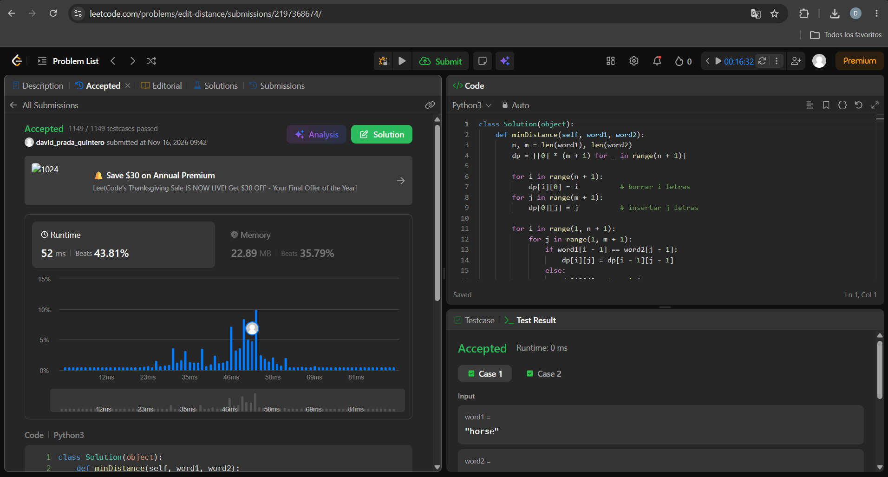
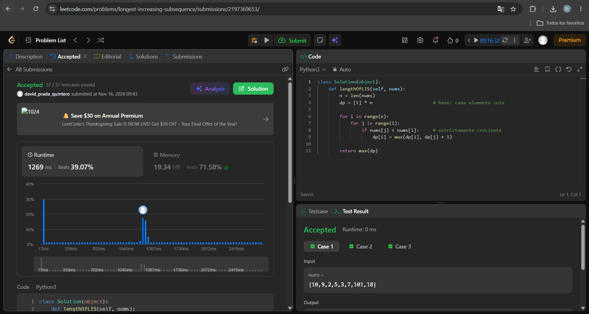

# Taller final · Análisis de algoritmos · ITM 2026-2

## Autoría

| Integrante | Usuario de git | Ejercicios |
| --- | --- | --- |
| David Prada Quintero | `DavidP03` | 72, 300 |
| … | … | … |
| … | … | … |
| … | … | … |

## 72. Edit Distance

Enlace: https://leetcode.com/problems/edit-distance/  
Autor: David Prada Quintero (`tu-usuario-github`)  
Código: [edit-distance/solution.py](edit-distance/solution.py)  
Familia: programación dinámica  
Idea: estado `dp[i][j]` = número mínimo de ediciones para convertir `word1[0..i)` en `word2[0..j)`. Base: `dp[i][0] = i` (borrar `i` letras) y `dp[0][j] = j` (insertar `j` letras). Recurrencia: si `word1[i-1] == word2[j-1]`, `dp[i][j] = dp[i-1][j-1]`; si no, `dp[i][j] = 1 + min(dp[i-1][j], dp[i][j-1], dp[i-1][j-1])` (borrar, insertar, sustituir). La respuesta es `dp[n][m]`.  
Complejidad: tiempo `Θ(n·m)` y espacio `Θ(n·m)`, con `n = word1.length` y `m = word2.length`.

## 300. Longest Increasing Subsequence

Enlace: https://leetcode.com/problems/longest-increasing-subsequence/  
Autor: David Prada Quintero (`tu-usuario-github`)  
Código: [longest-increasing-subsequence/solution.py](longest-increasing-subsequence/solution.py)  
Familia: programación dinámica  
Idea: estado `dp[i]` = longitud de la subsecuencia estrictamente creciente más larga que termina en el índice `i`. Base: `dp[i] = 1` (el elemento solo). Recurrencia: `dp[i] = max(dp[i], dp[j] + 1)` para todo `j < i` con `nums[j] < nums[i]`. La respuesta es `max(dp)`, porque la LIS puede no terminar en el último elemento.  
Complejidad: tiempo `Θ(n²)` y espacio `Θ(n)`, con `n = nums.length`.

